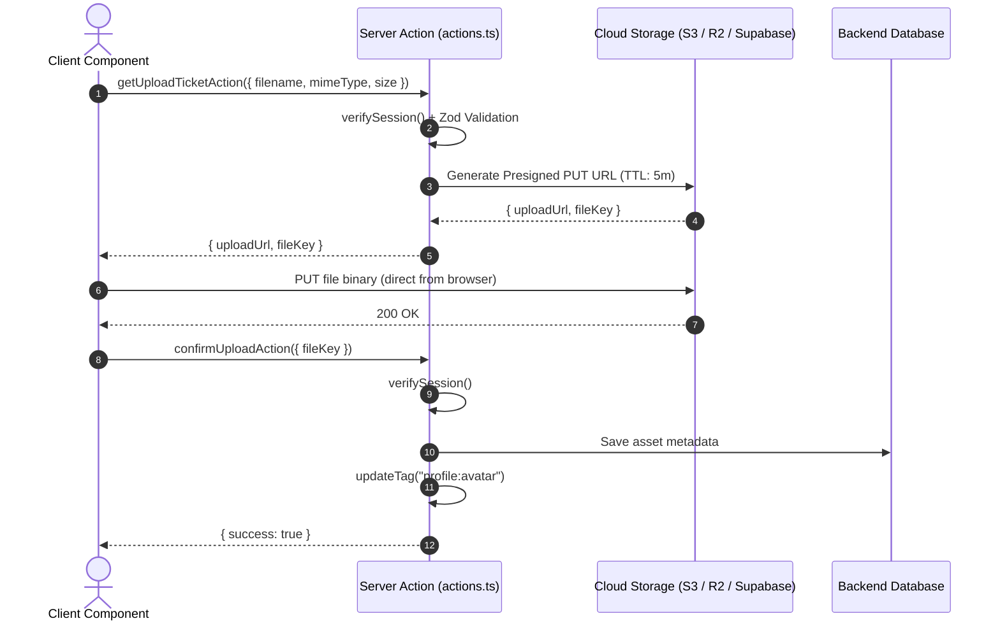

# Advanced Data Fetching, Caching & Production Patterns

Production extensions for `apps/studio` running on **Next.js 16.4.2** with `cacheComponents: true` and `partialPrefetching: true`.
Complements [data-fetching.md](data-fetching.md) and [authentication.md](authentication.md).
Sources resolve from `apps/studio/node_modules/next/dist/docs/01-app/` (`DOCS/`).

---

## 1. Instant Navigation & Regression Testing (`@next/playwright`)

### 1.1 Mental Model
With Cache Components and Partial Prefetching a client navigation should show the **App Shell + Fallback UI immediately**, while dynamic segments stream in. A default `<Link>` (`prefetch="auto"`) prefetches only the route's App Shell. Under `instant()` a default link is restricted to that shell: it ignores the per-URL page prefetch (`__PAGE__` segments), even when the browser already holds one. Content that depends on `params`/`searchParams` therefore reaches the screen only if the link sets `prefetch={true}` (for a listing that reads `searchParams` that is one uncacheable runtime render per link; for a statically prerendered page such as a known product slug it is a cacheable static response). A `[slug]` page that awaits `params` outside `<Suspense>` has an empty shell, so under the lock the navigation does not even commit: every dynamic-segment page must read `params` inside a `<Suspense>` with a sized fallback.
A developer calling `await cookies()`, `await searchParams`, or uncached I/O at the top level of a shared layout or page causes the same "blocking route" regression. `@next/playwright` provides `instant()` to lock this behavior in E2E tests (`DOCS/02-guides/instant-navigation.md`); the gate is `apps/studio/e2e/instant.spec.ts`.

### 1.2 Setup
What exists in the repo:
- `@next/playwright` is pinned to the exact Next version (`16.4.2`) in the `apps/studio` devDependencies (`pnpm --filter=studio add -D -E @next/playwright@<next version>`; keep both in step).
- `apps/studio/next.config.ts` sets `experimental.exposeTestingApiInProductionBuild: process.env.EXPOSE_TESTING_API === "1"`. Without the flag the build has no testing API and `instant()` locks nothing.
- `EXPOSE_TESTING_API` is declared in `turbo.json` `build.env`, so a flagged build never reuses a cached unflagged one.
- Scripts in `apps/studio/package.json`: `test:e2e` (all specs) and `test:e2e:instant` (`playwright test e2e/instant.spec.ts --workers=1`). The instant file skips itself unless `EXPOSE_TESTING_API=1`, so plain `pnpm test:e2e` never runs it.
- `next dev` does not prefetch, so only a production build can prove instant navigation.

### 1.3 Test Implementation Pattern
Each test starts from a full page load of the source page (visited routes stay mounted in `<Activity>` and would be trivially instant), scrolls the link into view so its viewport prefetch can finish, then clicks inside `instant()`:

```ts
// apps/studio/e2e/instant.spec.ts (simplified)
import { instant } from "@next/playwright"
import { expect, test } from "@playwright/test"

test("Category listing -> product", async ({ page }) => {
  await page.goto("/danh-muc/sofa")
  const card = page.locator('main:visible a[href^="/san-pham/"]').first()
  await card.scrollIntoViewIfNeeded()
  await page.waitForLoadState("networkidle") // let the viewport prefetch finish

  // `page` first, then the scope. `{ baseURL }` is only needed when `page.goto` is the first
  // navigation inside the scope (the canary): the instant cookie then needs an origin. Here the
  // page is already loaded, so the option is omitted.
  await instant(
    page,
    async () => {
      await card.click()
      // a navigation that cannot commit from its prefetch hangs here: fail fast, not at 30 s
      await page.waitForURL((url) => url.pathname.startsWith("/san-pham/"), {
        timeout: 5_000,
      })
      await expect(
        page.locator("main:visible").getByRole("heading", { level: 1 })
      ).toBeVisible()
    }
  )
})
```

Rules the spec follows: assert only after `waitForURL`; scope every locator to `main:visible` (hidden routes stay mounted); use roles (the `h1`) instead of test ids; assert the destination content, not just that a skeleton appeared. A test that starts showing a skeleton means a navigation became blocking: fix the app, do not relax the test.

### 1.4 Gate Runbook
The gate is a **local** gate (see 1.8). It needs a production build with the flag, and `next start` must get the flag too (it re-reads `next.config.ts`; without it the server ignores the instant cookie and the canary fails).

Git Bash:
```bash
EXPOSE_TESTING_API=1 pnpm --filter studio build
EXPOSE_TESTING_API=1 pnpm --filter studio exec next start -p 3100
# second terminal
EXPOSE_TESTING_API=1 BASE_URL=http://localhost:3100 pnpm --filter studio test:e2e:instant
```
PowerShell:
```powershell
$env:EXPOSE_TESTING_API="1"; pnpm --filter studio build
$env:EXPOSE_TESTING_API="1"; pnpm --filter studio exec next start -p 3100
# second terminal
$env:EXPOSE_TESTING_API="1"; $env:BASE_URL="http://localhost:3100"; pnpm --filter studio test:e2e:instant
```
- The script pins `--workers=1` itself. The lock is per browser context, and with 7 workers it timed out (observed, not explained); do not override it.
- Afterwards rebuild WITHOUT the flag (`pnpm --filter studio build`), so `apps/studio/.next` is not left with the testing API.
- **Never set `EXPOSE_TESTING_API` on Vercel or any deploy/CI build.** The flag ships the testing API in the production bundle.
- **Canary**: the first test locks a document load of `/danh-muc/sofa` and asserts the header (shell) is visible while the listing cards are absent. It fails on a build or server without the flag, which is the only thing that stops the other six tests from passing vacuously (without the flag they all pass). If the cards do not appear within 5 s of releasing the lock, the test records a `reload-after-release` annotation and reloads; this is a suspected Next / `@next/playwright` quirk that never occurred in the recorded runs, and the reload proves only that the page recovers, not streaming after release.
- **Home tiles**: `Home -> category shows the listing fallback` asserts what the locked navigation shows today: the URL commits and the sized listing fallback (`.animate-pulse` block) is visible, with no heading and no cards. It guards the `<Suspense>` around `params` in `danh-muc/[slug]` (without it the navigation never commits). The full-content variant (heading + cards, like the other listing flows) is deliberately not asserted: the category page reads `searchParams`, so a tile would need `prefetch={true}`, one uncacheable runtime render per tile (12 on the home page); tiles stay on the default prefetch (see 1.7). Separately, unlocked clicks on this navigation show a bimodal ~340 ms slow mode (see 1.5) whose cause is unexplained.
- **Search cold start**: the first spec run right after a rebuild failed `Search -> product` in 4 of 4 cases (panel stuck on "Đang tìm…", the browser's suggestion RPC had not returned); a second run, or restarting the server on the same build, passed. Cause not found. The spec waits 15 s for the suggestion; if it still flakes, re-run before suspecting the app.

**Sensitivity checks.** Temporary mutations on the final tree (flagged build, 7-test spec, edits reverted with `git checkout`, never committed). Base: all 7 pass.

| Mutation | Tests that fail |
| :--- | :--- |
| base (no mutation) | none (7 pass) |
| (a) plain build and plain server, no flag (Task 2, not re-run) | canary (4 cards visible in a locked load); the others pass vacuously |
| (b) remove `"use cache"` from `getProduct` (awaited outside Suspense; Task 2, not re-run) | `next build` fails (`encountered uncached or runtime data during prerendering`); no runtime test |
| (b') remove `"use cache"`, `cacheLife`, `cacheTag` from `fetchListPage` (inside Suspense) | Header menu -> Sản phẩm (its `prefetch={true}` listing no longer has the content in the prefetch) |
| (c) `await connection()` at the top of `ProductPage` | `next build` fails with the same prerender error (Task 2, not re-run) |
| (c') `await connection()` in `ListingBody` (inside Suspense) | Header menu -> Sản phẩm |
| (e) remove the `<Suspense>` around `params` in `danh-muc/[slug]` | Home -> category shows the listing fallback (`waitForURL` timeout: the navigation never commits) |

Mutations (b) and (c) break `next build` rather than a test: Cache Components rejects blocking data awaited outside Suspense at build time, so the build is the guard for that class. Home -> category no longer catches (b') and (c'): with default-link tiles it only sees the shell, so the Header menu test is what guards the cached listing.

### 1.5 Baseline Numbers
Chromium against a local production build (unflagged), Supabase cloud; method and caveats in [the instant navigation report](superpowers/reports/2026-10-23-instant-navigation-report.md).

| Metric | Baseline (`64c515b`) | After (`85cb580` and later) |
| :--- | :--- | :--- |
| Idle prefetch requests per page | 8-13 (about three quarters `/_tree`) | 8-13 (same band; product cards 3-5) |
| Product prefetches from scrolling | 0 | 0 |
| Product prefetches from hovering 15 cards | 0 | 11 (intended: intent) |
| Click to destination h1 (card, search, menu, related) | 30-57 ms; Header menu had two 335-351 ms outliers | 29-44 ms; no menu outlier in the sample |
| Click to destination h1, Home -> category | ~44 ms at `64c515b` (10/10); a later re-measurement is bimodal | bimodal on both trees: ~30-65 ms or ~330-350 ms |
| `instant.spec.ts` | 1 pass, 6 fail | 7 pass |

### 1.6 Rules
Add things only when data asks for them: a failing instant test or a measured cost.
- **Default `<Link>`** first. It is enough when the destination shell is useful (static header, fallback).
- Listings that read `searchParams` are not eagerly prefetched: each prefetch is an uncacheable runtime render (`Next-Router-Prefetch: 2`, `private, no-store`).
- **`navigation()`** and **`"use cache: remote"`** only after a failing instant test or a measured server cost shows the need.
- Before and after any prefetch change, count prefetch requests at idle, after scrolling and after hovering (the report describes the method) and keep them within the baseline band.

### 1.7 Deliberately Not Adopted
- **Eager `prefetch` on the home tiles**: measured on a full home scroll, total prefetches rose from 22-23 to 35 on desktop (1.56x) and from 17 to 29 on mobile (1.7x), including 12 uncacheable `Next-Router-Prefetch: 2` renders (the comparison is the same page with default-link tiles, not the Task 3 baseline). Tiles stay on the default link; their locked navigation shows the fallback (see the Home tiles bullet in 1.4).
- **Pending feedback on the search sheet**: the sheet stays open until the navigation commits (it closes on the pathname change, so the suggestion link is not unmounted mid-navigation); there is no pending indicator. A follow-up if it feels slow.
- **The `next-partial-prefetching-optimizer` skill**: it edits code autonomously; changes here come from a measured diagnosis instead.
- **`"use cache: remote"`**: no test or measurement needs it, and it adds a cache handler dependency (see §2).
- **`navigation()`**: no navigation-only content is needed to pass the gate.
- **`loading.tsx`**: the `<Suspense>` fallbacks sit beside the data and are sized; a route-level `loading.tsx` would hide whole pages behind one skeleton.

### 1.8 CI Decision
Ruling: the gate stays a documented local gate. CI (`.github/workflows/ci.yml`) runs `lint typecheck test build --affected` and has no e2e job. Reasons: CI has only placeholder Supabase env (`NEXT_PUBLIC_SUPABASE_URL=http://127.0.0.1:54321`), while the spec needs the seeded cloud catalogue; it needs a flagged build, kept out of the normal `build` step; and the first run after a build was not shown stable over five consecutive runs (Search cold start).
To add it, all of these must hold: a seeded data source reachable from CI without unsafe secrets (a local Supabase stack seeded in the job, or a read-only test project); a separate job that builds with the flag and never deploys or uploads that build; the Search cold start understood or removed; five consecutive green runs.

---

## 2. Distributed Remote Cache (`cacheHandlers` + Redis / Upstash)

### 2.1 Why and When
The default cache store in Next.js 16 is an in-memory LRU cache limited to 50 MB (`cacheMaxMemorySize`).
In serverless environments (Vercel, AWS Lambda) or multi-container clusters (Docker/Kubernetes):
- Memory is ephemeral and isolated per container/instance.
- In-memory entries do not survive serverless container restarts or scale-out events.

`"use cache: remote"` combined with `cacheHandlers` in `next.config.ts` delegates storage to a shared external store (e.g. Redis, Keyv, DynamoDB) (`DOCS/03-api-reference/05-config/01-next-config-js/cacheHandlers.md`).

### 2.2 Implementing `CacheHandler`
A custom cache handler must implement the 5 required methods from `next/cache`:
`get`, `set`, `refreshTags`, `getExpiration`, `updateTags`.

> [!IMPORTANT]
> - `entry.value` arrives as a `ReadableStream<Uint8Array>`. It can only be consumed once. Do NOT store the stream directly; buffer the bytes into your storage.
> - On every `get()` hit, wrap the stored bytes in a **fresh** `new ReadableStream()`.
> - Never store tokens, passwords, or PII in `cacheKey` or tags.

```ts
// apps/studio/cache-handlers/redis-handler.js
const { createClient } = require('redis')

const client = createClient({ url: process.env.REDIS_URL })
client.connect().catch((err) => console.error('Redis Cache Handler error:', err))

const localTagTimestamps = new Map()

module.exports = {
  async get(cacheKey, softTags) {
    try {
      const raw = await client.get(`cache:${cacheKey}`)
      if (!raw) return undefined

      const data = JSON.parse(raw)

      // Reconstruct single-use ReadableStream over stored base64 bytes
      return {
        value: new ReadableStream({
          start(controller) {
            controller.enqueue(Buffer.from(data.value, 'base64'))
            controller.close()
          },
        }),
        tags: data.tags,
        stale: data.stale,
        timestamp: data.timestamp,
        expire: data.expire,
        revalidate: data.revalidate,
      }
    } catch {
      // Safe fallback on cache failure: return undefined to trigger dynamic render
      return undefined
    }
  },

  async set(cacheKey, pendingEntry) {
    const entry = await pendingEntry
    const reader = entry.value.getReader()
    const chunks = []

    try {
      while (true) {
        const { done, value } = await reader.read()
        if (done) break
        chunks.push(value)
      }
    } finally {
      reader.releaseLock()
    }

    const buffer = Buffer.concat(chunks.map((c) => Buffer.from(c)))

    await client.set(
      `cache:${cacheKey}`,
      JSON.stringify({
        value: buffer.toString('base64'),
        tags: entry.tags,
        stale: entry.stale,
        timestamp: entry.timestamp,
        expire: entry.expire,
        revalidate: entry.revalidate,
      }),
      { EX: entry.expire } // Redis TTL
    )
  },

  async refreshTags() {
    // Sync invalidated tags from Redis before serving cache entries
    const tagKeys = await client.sMembers('revalidated-tags')
    if (tagKeys.length > 0) {
      const values = await client.mGet(tagKeys.map((k) => `tag:${k}`))
      for (let i = 0; i < tagKeys.length; i++) {
        localTagTimestamps.set(tagKeys[i], Number(values[i]))
      }
    }
  },

  async getExpiration(tags) {
    const timestamps = tags.map((t) => localTagTimestamps.get(t) || 0)
    return Math.max(...timestamps, 0)
  },

  async updateTags(tags, durations) {
    const now = Date.now()
    const pipeline = client.multi()
    for (const tag of tags) {
      pipeline.set(`tag:${tag}`, String(now))
      pipeline.sAdd('revalidated-tags', tag)
      localTagTimestamps.set(tag, now)
    }
    await pipeline.exec()
  },
}
```

### 2.3 Configuration in `next.config.ts`
```ts
// apps/studio/next.config.ts
import type { NextConfig } from 'next'

const nextConfig: NextConfig = {
  cacheComponents: true,
  partialPrefetching: true,
  cacheHandlers: process.env.REDIS_URL
    ? {
        remote: require.resolve('./cache-handlers/redis-handler.js'),
      }
    : undefined,
}

export default nextConfig
```

### 2.4 Code Directive Usage
```ts
// features/reports/queries.ts
import { cacheLife, cacheTag } from 'next/cache'

export async function getAggregatedReport(dateRange: string) {
  'use cache: remote'
  cacheTag('reports:aggregated')
  cacheLife('hours')
  return fetchExpensiveReportFromBackend(dateRange)
}
```

---

## 3. Large File & Media Uploads (Presigned URL Architecture)

### 3.1 Constraints
- Next.js Server Actions have a default body limit (`serverActions.bodySizeLimit: '1mb'`).
- Streaming large payloads (10 MB – 1 GB+) through Node.js or serverless instances exhausts memory, blocks the event loop, and causes timeout failures.

### 3.2 The Presigned Direct Upload Pattern
To preserve high performance and keep the DAL boundaries clean:
1. **Request Upload Ticket**: Client Component calls a Server Action to request a presigned URL.
2. **Authorize & Sign**: Server Action validates session (`verifySession`), checks authorization, enforces MIME type / max file size via Zod, and requests a Presigned PUT URL from storage (S3 / Cloudflare R2 / Supabase Storage).
3. **Direct Upload from Browser**: Client sends the raw file binary directly to cloud storage via `fetch` with `PUT`.
4. **Confirm & Invalidate**: Client calls a second Server Action to confirm the upload, record the asset in the database, and call `updateTag()` to refresh UI caches.



---

## 4. Real-time Streaming & Live Data (SSE & Channels)

### 4.1 Server-Sent Events (SSE) Route Handler
When a feature requires live updates without installing heavy client libraries, Server-Sent Events (SSE) can be implemented in a Route Handler.

> [!NOTE]
> **Why `connection()` here instead of `io()`?**
> In normal Server Components and queries, the repo rule is **prefer `io()` from `next/cache`** because `io()` allows prefetching and works inside `"use cache: private"`. Values that per-user reads depend on (the DAL's `getSession`, `getToday` in `lib/clock.ts`) go one step further and are `"use cache: private"` themselves, so the reads after them stay in the App Shell (data-fetching §1, §4.3).
> However, an SSE Route Handler is one of the rare legitimate use cases for `connection()` from `next/server`: you **must wait for a real user request** and **deliberately block prefetching** (`DOCS/03-api-reference/04-functions/io.md`). You never want a `<Link>` hover or prefetch to trigger an open, persistent event stream and leak server connections.

```ts
// apps/studio/app/api/live-events/route.ts
import { connection } from 'next/server'
import { verifySession } from '@/lib/dal'

export async function GET(request: Request) {
  // 1. Wait for real user request & block any prefetch
  await connection()

  // 2. Authorize
  const session = await verifySession()
  if (!session) {
    return new Response('Unauthorized', { status: 401 })
  }

  // 3. Create readable stream
  const encoder = new TextEncoder()
  const stream = new ReadableStream({
    start(controller) {
      const interval = setInterval(() => {
        const payload = `data: ${JSON.stringify({ timestamp: Date.now() })}\n\n`
        controller.enqueue(encoder.encode(payload))
      }, 3000)

      request.signal.addEventListener('abort', () => {
        clearInterval(interval)
        controller.close()
      })
    },
  })

  return new Response(stream, {
    headers: {
      'Content-Type': 'text/event-stream',
      'Cache-Control': 'no-cache, no-transform',
      Connection: 'keep-alive',
    },
  })
}
```

### 4.2 Revalidating Server Components from Real-time Events
When a real-time event arrives on the client (via SSE or Supabase Realtime Channels), instead of keeping parallel state in React state:
1. Call `router.refresh()`.
2. Next.js re-executes the route's Server Components in the background.
3. React reconciles and updates the DOM in-place without losing client state (form inputs, focus, scroll position).

---

## 5. Observability, Background Tasks & Error Telemetry

### 5.1 Non-blocking Work with `after()`
`after()` (from `next/server`) schedules asynchronous work to run **after** the response stream has completed (`DOCS/03-api-reference/04-functions/after.md`).
Use it for audit logs, analytics, and notification dispatch without delaying the user's paint:

```ts
// features/<domain>/actions.ts
'use server'
import { after } from 'next/server'
import { verifySession } from '@/lib/dal'
import { updateTag } from 'next/cache'

export async function updateItemAction(itemId: string, note: string) {
  const session = await verifySession()

  // 1. Critical path: write to DB
  await patchItem(session.accessToken, itemId, { note })
  updateTag(`items:${session.userId}`)

  // 2. Non-blocking: background telemetry & audit log
  after(async () => {
    await sendAuditLog({
      userId: session.userId,
      action: 'item.update',
      itemId,
      timestamp: Date.now(),
    })
  })

  return { success: true }
}
```

### 5.2 Centralized Server Error Tracking with `instrumentation.ts`
Next.js 16 provides the `onRequestError` export in `instrumentation.ts` to capture unhandled errors across Server Components, Route Handlers, Server Actions, and Proxy (`DOCS/03-api-reference/03-file-conventions/instrumentation.md`):

```ts
// apps/studio/instrumentation.ts
import type { Instrumentation } from 'next'

export function register() {
  // Initialize OpenTelemetry SDK if configured
}

export const onRequestError: Instrumentation.onRequestError = async (
  err,
  request,
  context
) => {
  const errorMessage = err instanceof Error ? err.message : String(err)
  const digest =
    typeof err === 'object' && err !== null && 'digest' in err
      ? String((err as { digest?: unknown }).digest)
      : undefined

  // Filter out normal control-flow throws (redirect() and notFound() throw internal symbols)
  if (errorMessage.includes('NEXT_REDIRECT') || errorMessage.includes('NEXT_NOT_FOUND')) {
    return
  }

  const payload = {
    message: errorMessage,
    digest,
    path: request.path,
    method: request.method,
    routeType: context.routeType,     // 'render' | 'route' | 'action' | 'proxy'
    routerKind: context.routerKind,   // 'App Router' | 'Pages Router'
    timestamp: new Date().toISOString(),
  }

  // Forward to centralized monitoring (e.g. Sentry, Datadog, or external log collector)
  console.error('[SERVER_ERROR]', JSON.stringify(payload))
}
```

---

## 6. Production Architecture Checklist

- [ ] **E2E Regressions**: High-value flows (e.g. Dashboard, Case Lists) have `@next/playwright` `instant()` test coverage.
- [ ] **Distributed Cache**: If deploying on multi-instance serverless/containers, `cacheHandlers.remote` is connected to Redis/Upstash.
- [ ] **File Uploads**: Files larger than 1 MB bypass Server Actions and use presigned direct-to-storage URLs.
- [ ] **Live Data**: SSE handlers call `await connection()` and coordinate with `router.refresh()`.
- [ ] **Telemetry**: Server Actions offload audit logs to `after()`; server crashes are captured in `instrumentation.ts` via `onRequestError`.
